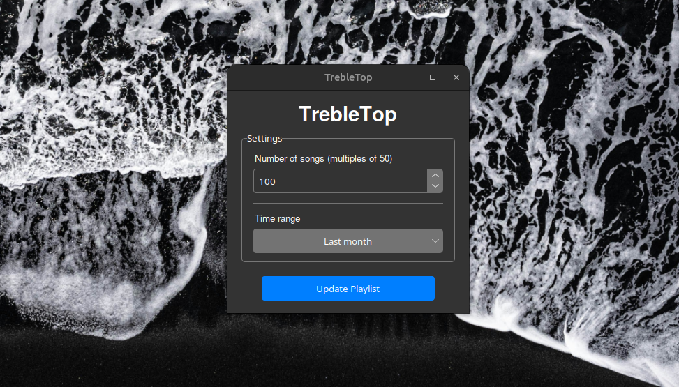

# TrebleTop - Spotify playlist automation app

TrebleTop is a small Linux desktop app that automatically updates one of your Spotify playlists with your most listened songs. The number of songs in the playlist and the time range are chosen by the user.
Here is a screenshot of the user interface:



## Setup

You need Linux, Python 3, `make` and Tkinter (on Debian/Ubuntu: `sudo apt install python3-venv python3-tk`).

### 1. Get the code and install

```
git clone https://github.com/Aendriuw/Trebletop-Spotify-Playlist-Automation
cd Trebletop-Spotify-Playlist-Automation
make install
make shortcut
```

`make install` creates a `venv` folder with the dependencies. `make shortcut` adds the `trebletop` and `trebletop-update` commands to `~/.local/bin`, so make sure that folder is in your `PATH`.

### 2. Create a Spotify app

1. Go to https://developer.spotify.com/dashboard and log in.
2. Click **Create app**.
3. Website: `http://localhost:8888`
4. Redirect URI: `http://127.0.0.1:8888/callback`
5. Save it and note the **Client ID** and **Client Secret** (under Settings).

### 3. Get your playlist ID

Open your playlist and copy its link. The ID is between `playlist/` and `?`:

`https://open.spotify.com/playlist/<playlist_id>?...`

The playlist must be one you own.

### 4. Fill in the .env file

```
cp .env_example .env
```

Open `.env` and fill in your Client ID, Client Secret and playlist ID. Keep the redirect URI the same as in step 2. Never share this file.

## Usage

### GUI

```
trebletop
```

Choose the number of songs (a multiple of 50) and the time range, then click update.

On the first run a browser window opens so you can authorise the app with your Spotify account. After that you stay logged in.

### Terminal

```
trebletop-update <number_of_songs> <time_period>
```

The time period is `last_month`, `six_months` or `all_time`. Example:

```
trebletop-update 100 six_months
```

### Uninstall the commands

```
make uninstall
```

## Resources used

### Spotipy & the Spotify Web API

**Spotipy** is a Python wrapper around the **Spotify Web API**. The program uses it to:
- Authenticate with your Spotify account using `SpotifyOAuth`
- Read your **top tracks** using the `current_user_top_tracks` endpoint
- Modify a playlist using the `playlist_replace_items` endpoint

### Azure ttk Theme

The UI uses the **Azure ttk theme** (https://github.com/rdbende/Azure-ttk-theme) by **rdbende**. It is included in this repository with its original MIT license.
